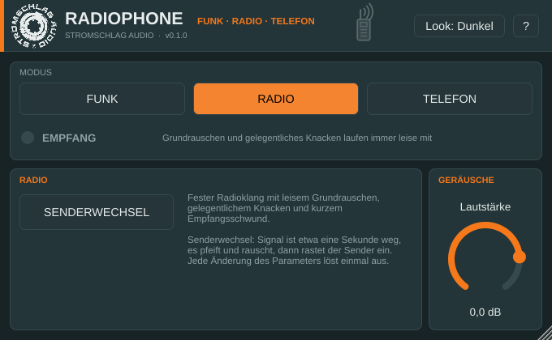

# RADIOPHONE – Audio Drama Radio & Phone Simulator

<picture>
  <source media="(prefers-color-scheme: dark)" srcset="docs/logo-dunkel.png">
  
</picture>

VST3-Insert-Effekt für Hörspiel-Produktion. Er lässt eine Stimme oder Musik klingen, als käme sie aus einem
Funkgerät, einem Radio oder einem Telefon, und bringt die passenden Geräusche gleich mit: das Tschk und Kschhh
der Sprechtaste, Rauschen und Knacken im Radio, Wählton, Wählscheibe, Freizeichen und das Klacken des Hörers.

**⬇ Download (Windows · VST3 · Stereo):** https://github.com/StromschlagProductions/Radiophone-vst/releases/latest

## Warum es dieses Plugin gibt

In fast jedem meiner Hörspiele kommt irgendwann eine Funkdurchsage, ein Radio oder ein Telefonat vor. Den Klang
habe ich bisher mit einer Lautsprecher-Simulation gemacht und die Squelch-Geräusche, Wähltöne und Störungen von
Hand in eine eigene Effektspur gelegt. Das kostet bei jeder Szene Zeit.

RADIOPHONE legt den Klang drauf und erzeugt die Geräusche selbst, an der richtigen Stelle. Der Klang ist fest
abgestimmt: Plugin auf die Spur, Modus wählen, fertig. Es gibt keinen Mix- und keinen Ausgangsregler, die Spur
läuft komplett durch den Effekt.

– Lars Eickstädt, Stromschlag Audio

*RADIOPHONE soll niemandem die Erfahrung abnehmen, Funk und Radio selbst zu gestalten. Gerade am Anfang kann es viel Spaß machen und lehrreich sein, einen Funkspruch selbst aufzubauen und zu hören, wie Bandbreite, Rauschen und Verzerrung ineinandergreifen. Ich bin dankbar, dass ich diesen Weg selbst gegangen bin, auch wenn er manchmal umständlich und mühselig war. Gerade dadurch weiß ich, was ich mir von einem Werkzeug wünsche, das all das in einem vereint. RADIOPHONE soll das Gestalten nicht ersetzen, sondern die technische Umsetzung im Alltag einfacher machen.*

## Oberfläche

| Funk (dunkel) | Radio (dunkel) | Telefon (hell) |
|---|---|---|
|  |  |  |

Oben wählt man den Modus, darunter zeigt eine Lampe den Zustand (SENDET, SENDERWECHSEL, GESPRÄCH). Der
**?**-Knopf öffnet die Hilfe, Look Dunkel/Hell und die Fenstergröße (50–300 %) werden mit dem Projekt gespeichert.

## Modi und Regler (alle automatisierbar)

### Funk

Das Squelch-Geräusch hängt an der Sprechtaste, nicht an Sprechpausen: Taste drücken = kurzes **Tschk**,
Taste loslassen = **Kschhh** mit hartem Ende. Solange die Taste gedrückt ist, hört man ein leises Kanalrauschen
unter der Stimme. Ist sie losgelassen, ist der Empfänger stumm.

| Regler | Wirkung |
|---|---|
| **Gerät** | Walkie-Talkie (schmal, rau, langes Kschhh), Autofunk (mittig, kurzes Kschhh), Tischfunk (voller) |
| **Sprechtaste** | **Automatik:** öffnet beim ersten Wort (das Tschk liegt kurz davor), schließt erst nach der eingestellten Pause. Kurze Pausen zwischen Wörtern oder Sätzen lösen nichts aus. **Gedrückt / Losgelassen:** volle Kontrolle per Automation. |
| **Pause bis Ende** | nur Automatik: so lange Stille (0,2–3 s, Standard 0,6 s), bis die Taste als losgelassen gilt |
| **Abhacken** | aus = sauber. Je weiter aufgedreht, desto eher bricht die Verbindung bei leisen Stellen hart weg. |

### Radio

Fester Radioklang (kleiner Lautsprecher, etwas Sendekompression) mit leisem Grundrauschen und gelegentlichem
Knacken. Passt auf Musik und auf Durchsagen.

| Regler | Wirkung |
|---|---|
| **Störungen** | Wie oft und wie stark der Empfang schlecht wird: Die Stimme sackt ab und geht ins Gruscheln, das Rauschen kommt hoch, dann ist sie wieder da. aus = keine Störungen, voll = häufig und stark (Standard 50 %). |
| **Senderwechsel** | Knopf oder Automation. Jede Änderung dreht den Sender weiter: Das Signal ist etwa eine Sekunde weg, es pfeift und rauscht, dann rastet der Sender ein. |

### Telefon

Fester Telefonklang (schmale Leitung, Kohlemikrofon). Der Ablauf eines Anrufs wird über den Zustand der Leitung
gesteuert. Die Stimme ist nur bei **Gespräch** zu hören.

| Regler | Wirkung |
|---|---|
| **Leitung** | Gespräch · Aufgelegt · Wählton (425 Hz) · Wählen · Freizeichen (1 s Ton, 4 s Pause) · Besetzt. Weg von *Aufgelegt* = Hörer abnehmen (Klacken), hin zu *Aufgelegt* = Auflegen. Andere Wechsel knacken kurz in der Leitung. |
| **Wählart** | Wählscheibe (Impulse, typisch für die 80er) oder Tasten (Töne). Gewählt wird, bis man auf Freizeichen umschaltet. |

### Für alle Modi

| Regler | Wirkung |
|---|---|
| **Geräusche – Lautstärke** | Pegel aller eingebauten Geräusche (Squelch, Rauschen, Knacken, Senderwechsel, Telefontöne), −24 bis +6 dB. Die Stimme bleibt davon unberührt. |

## Anwendung

- **Funkspruch, ohne etwas zu automatisieren:** Plugin auf die Sprecherspur, Modus Funk, Gerät wählen, Sprechtaste
  auf Automatik. Jeder Take bekommt sein Tschk am Anfang und sein Kschhh am Ende.
- **Funkspruch mit genauer Kontrolle:** Sprechtaste auf Losgelassen, dann in der Automationsspur „Funk: Sprechtaste“
  vor jeder Durchsage auf Gedrückt und danach wieder auf Losgelassen stellen.
- **Radio in der Ecke:** Musik- oder Sprecherspur auf Radio. Für den Raum (Radio steht hinten rechts) danach
  LOCATIONS oder den Pan am Kanal benutzen. Für „Musik hört auf, Sprecher setzt ein“ an der Stelle einen
  Senderwechsel setzen.
- **Anruf:** Spur auf Telefon, „Telefon: Leitung“ automatisieren, z. B. Aufgelegt → Wählton → Wählen →
  Freizeichen → Gespräch → Besetzt → Aufgelegt.

## Hinweise

- **Latenz:** Nur im Funkmodus 30 ms, Radio und Telefon haben keine. Der Vorlauf im Funkmodus ist nötig, damit das
  Tschk vor dem ersten Wort liegt: Die Automatik erkennt Sprache 3 bis 22 ms nach dem hörbaren Anfang und braucht
  dazu Reserve. Die DAW gleicht das automatisch aus (Plugin-Latenzausgleich). Wechselt man den Modus, meldet das Plugin die neue Latenz.
- Funk, Radio und Telefon sind mono: Eine Stereospur wird zusammengemischt und auf beide Seiten gelegt.
- Die Stimme kommt etwa so laut heraus, wie sie hineingeht (ca. 1 dB leiser, durch die schmalere Bandbreite).

## Installation (Windows)

1. Über den Download-Link oben `Radiophone-VST3-Windows.zip` laden.
2. ZIP entpacken und den **ganzen Ordner** `Radiophone.vst3` nach `C:\Program Files\Common Files\VST3` kopieren.
3. DAW neu starten bzw. Plugins neu scannen.

## Versionen

Die Versionsnummer steht in der Datei `VERSION`, im Plugin-Kopf und im Namen der Release. Sie wird bei jeder
Änderung hochgezählt.

- **1.3** – Hilfe und README allgemein für jede DAW formuliert (kein Bezug mehr auf eine bestimmte DAW).
- **1.2** – Latenz von 80 auf 30 ms gesenkt (gemessen, nicht geschätzt), im Radio- und Telefonmodus 0.
- **1.1** – Radio: neuer Regler „Störungen“ (Empfangsschwund mit Gruscheln, einstellbar); Squelch und Senderwechsel
  nutzen jetzt eingebaute Aufnahmen aus der HörTalk-Community statt reiner Synthese.
- **1.0** – Untertitel „Audio Drama Radio & Phone Simulator“, Versionsnummer auf 1.0 gesetzt (die 0.x-Versionen waren Testläufe).
- **0.1.0** – Erste Testversion: Modi Funk (Walkie-Talkie, Autofunk, Tischfunk; Sprechtaste mit Automatik,
  Abhacken), Radio (Rauschen, Knacken, Schwund, Senderwechsel) und Telefon (Leitungszustände, Wählscheibe und
  Tasten, Hörergeräusche); Oberfläche im Stil von LOCATIONS mit Hilfe, Hell/Dunkel und skalierbarem Fenster.
- **0.0.2** – Parameterliste festgelegt.
- **0.0.1** – Platzhalter.

## Aufbau

- `Source/RadiophoneDSP.h`: Klang-Engine (reines C++). Die Klangwerte je Gerät stehen oben in `voicing()`.
- `Source/PluginProcessor.*`, `Source/PluginEditor.*`: JUCE-Plugin und Oberfläche
- `.github/workflows/build.yml`: automatischer Windows-Bau mit Stabilitätstest (pluginval) und Release

## Danke

Gebaut mit [JUCE](https://juce.com) 8. Die Sättigung (übersteuerter Funk- und Lautsprecherklang) folgt dem
Algorithmus von **Airwindows Density** von Chris Johnson ([github.com/airwindows](https://github.com/airwindows/airwindows), MIT-Lizenz).
Squelch und Senderwechsel nutzen Aufnahmen aus der HörTalk-Community, die dort frei nutzbar sind; die übrigen Geräusche werden im Plugin erzeugt.
